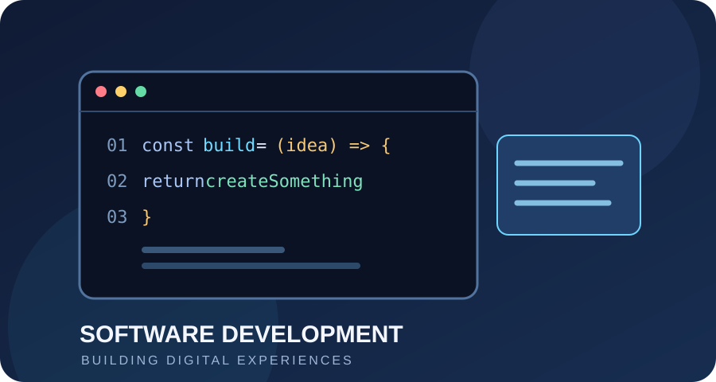
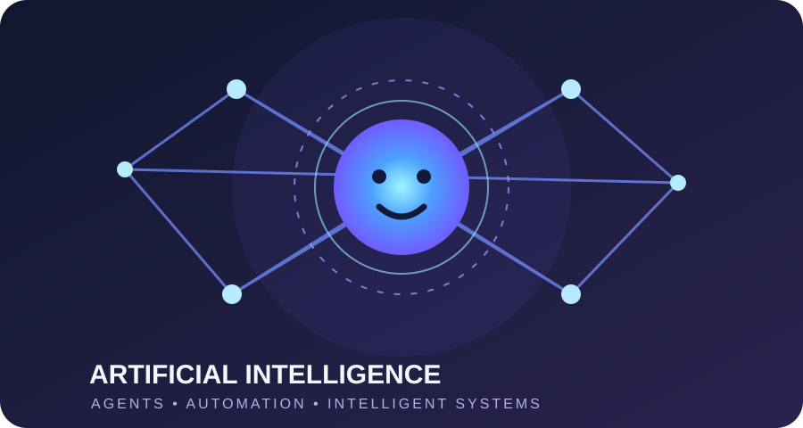
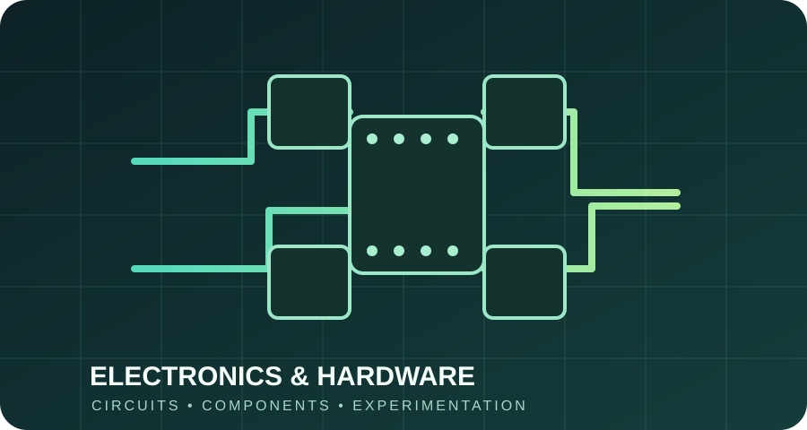

<!-- Profile README for github.com/mujtabasaad101 -->

### Computer Science Student · Web Developer · AI Enthusiast · Electronics Hobbyist

*I enjoy building at the intersection of software, intelligent systems, and hardware.*

---

## 👋 About Me

I'm **Mujtaba Saad**, a Computer Science student from Pakistan who likes exploring technology from both sides of the screen and the circuit board.

- 💻 Building modern websites and digital products.
- 🤖 Exploring AI agents, intelligent applications, and workflow automation.
- ⚡ Experimenting with electronics, circuit design, and hardware concepts.
- 🎨 Interested in clean interfaces, thoughtful product design, and user experience.
- 🧩 I enjoy learning by building, testing, and figuring out how things work.

## 🧭 My Three Areas of Interest

  <table>
    <tr>
      <td align="center" width="33%">
        
        <b>Software Development</b> 
        Web experiences · Applications · UI/UX
      </td>
      <td align="center" width="33%">
        
        <b>Artificial Intelligence</b> 
        AI agents · Automation · Intelligent tools
      </td>
      <td align="center" width="33%">
        
        <b>Electronics &amp; Hardware</b> 
        Circuit design · Components · Experiments
      </td>
    </tr>
  </table>

---

## 🚀 Featured Projects

### 01. Nexora Digital
A digital agency concept focused on web development, AI agents, and business automation.

### 02. SAM Enterprizes
A premium eastern-wear storefront with a luxury editorial visual direction and a modern shopping experience.

### 03. Mujtaba Portfolio
My personal portfolio website, bringing together my profile, interests, and selected work.

### 04. Ghar Kharch
An Android app concept for tracking household expenses and managing monthly budgets.

> The first three links point to live deployments. Their source repositories will be linked here once each deployment is matched to its correct GitHub repository.

---

## ⚡ Electronics & Hardware

My interest in technology isn't limited to software. I also enjoy understanding the components and circuits that make physical devices work.

**Topics I'm exploring:**
- Analog electronics and basic circuit design.
- Adjustable dual DC power supplies.
- Voltage regulation with **LM317** and **LM337**.
- Rectifiers, filters, diodes, and capacitors.
- Sensors, electronic components, and circuit troubleshooting.

I’m interested in turning theory into working, hands-on projects and documenting what I learn along the way.

## 🛠️ Technologies & Learning Areas

**Software & Web**

**AI & Automation**

**Electronics**

## 📈 GitHub Activity

  
  
   
  

---

## 🤝 Connect

**Always learning. Always building. Always curious.**

