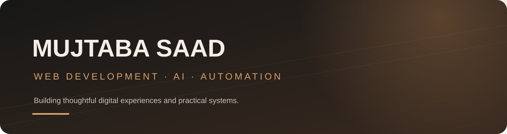

# Hi, I'm Mujtaba Saad 👋

I build modern web experiences and explore practical applications of **AI agents, automation, and software development**.

- 🎓 Computer Science student
- 💻 Interested in web development and product-focused design
- 🤖 Exploring AI agents and workflow automation
- 🌍 Based in Pakistan

## Featured projects

### 01 — Nexora Digital
A digital agency website focused on web development, AI agents, and automation.

**[Open live website](https://nexora-sand-one.vercel.app/)**

### 02 — SAM Enterprizes
A premium eastern-wear storefront with a luxury editorial visual direction.

**[Open live website](https://sam-enterprizes-pied.vercel.app/#/)**

### 03 — Mujtaba Portfolio
My personal portfolio website.

**[Open live website](https://mujtaba-portfolio-live.vercel.app/)**

## More projects

- **Ghar Kharch** — Android app concept for household expense tracking and monthly budgeting. See [App1](https://github.com/mujtabasaad101/App1).

## What I'm exploring

- Web development
- AI agents and automation
- Building useful digital products
- Clean UI and user experience

## Connect

- GitHub: [@mujtabasaad101](https://github.com/mujtabasaad101)

---

*This profile highlights selected live projects. Repository/source-code links will be added once each deployed site is matched to its correct GitHub repository.*
