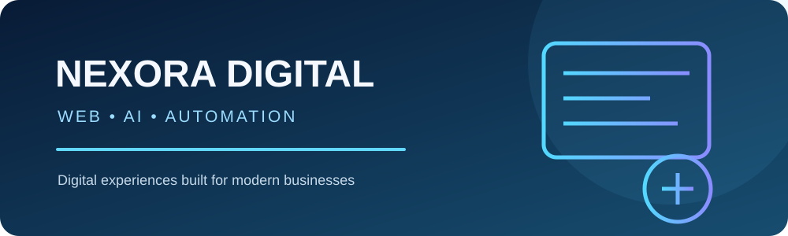
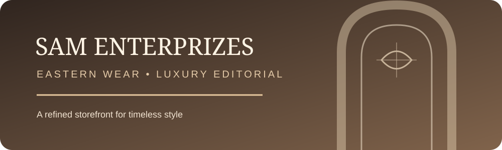
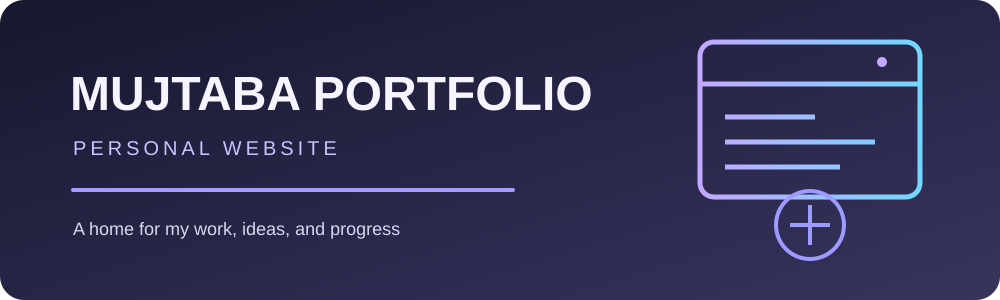
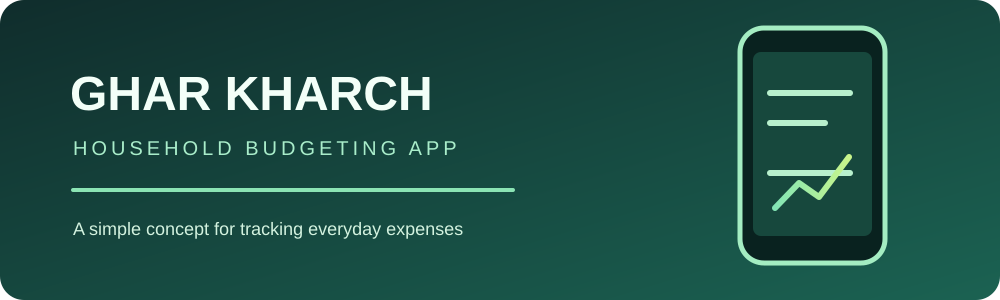

<!-- Profile README | github.com/mujtabasaad101 -->

### COMPUTER SCIENCE STUDENT  ·  WEB DEVELOPER  ·  AI ENTHUSIAST  ·  ELECTRONICS HOBBYIST

*Curious about how technology works — from the code on a screen to the circuits behind a device.*

---

## 👋 A little about me

I'm **Mujtaba Saad**, a Computer Science student based in Pakistan. I enjoy creating digital experiences, exploring practical AI applications, and learning electronics through hands-on experiments.

- 💻 Developing modern websites and digital products.
- 🤖 Exploring AI agents, intelligent systems, and workflow automation.
- ⚡ Learning electronics, circuit design, components, and hardware fundamentals.
- 🎨 Interested in clean UI, thoughtful design, and useful user experiences.
- 🧠 I learn best by building, testing, troubleshooting, and improving.

## 🧩 The three fields I enjoy

<table>
<tr>
<td width="33%" align="center" valign="top">

<strong>SOFTWARE</strong> 
Web development · Digital products · UI/UX
</td>
<td width="33%" align="center" valign="top">

<strong>ARTIFICIAL INTELLIGENCE</strong> 
AI agents · Automation · Intelligent tools
</td>
<td width="33%" align="center" valign="top">

<strong>ELECTRONICS</strong> 
Circuit design · Components · Hardware
</td>
</tr>
</table>

---

# 🚀 Selected Projects

A collection of websites and product ideas I've worked on. Each project has its own space below so you can explore it individually.

---

## 01 — Nexora Digital

**A digital agency website concept for modern businesses.**

Nexora Digital presents services around web development, AI agents, and business automation, with a focus on a polished digital presence.

**Project focus**

- Business-facing website and service presentation.
- Web development, AI, and automation positioning.
- Modern visual direction and responsive experience.

Live deployment · Source repository not yet matched

---

## 02 — SAM Enterprizes

**A premium eastern-wear storefront with a luxury editorial direction.**

This project explores how a fashion brand can present its products through an elegant storefront and a refined visual identity.

**Project focus**

- Eastern-wear brand presentation.
- Premium, editorial-inspired visual styling.
- Product-focused storefront experience.

Live deployment · Source repository not yet matched

---

## 03 — Mujtaba Portfolio

**My personal portfolio and digital home.**

A dedicated place to introduce myself, share selected work, and present my interests across software, AI, and electronics.

**Project focus**

- Personal branding and professional introduction.
- Selected projects and skills presentation.
- Clean layout and user experience.

Live deployment · Source repository not yet matched

---

## 04 — Ghar Kharch

**An Android app concept for household expense tracking.**

Ghar Kharch is focused on making everyday household spending easier to record and monthly budgeting easier to understand.

**Project focus**

- Household expense tracking concept.
- Monthly budgeting and spending awareness.
- Android application exploration.

Repository: App1

---

## ⚡ Electronics & Hardware

Software isn't the only side of technology that interests me. I also enjoy understanding the physical components and circuits that make devices work.

**Topics I'm learning and experimenting with**

- Analog electronics and basic circuit design.
- Adjustable dual DC power supplies.
- Voltage regulators such as **LM317** and **LM337**.
- Bridge rectifiers, diodes, capacitors, and filtering.
- Sensors, electronic components, and circuit troubleshooting.

I'm interested in taking concepts from diagrams to practical working circuits, documenting what I learn along the way.

## 🛠️ Current learning map

| Area | Exploring |
|:--|:--|
| **Web & Software** | Modern websites, application development, responsive UI |
| **AI & Automation** | AI agents, intelligent workflows, multi-agent concepts |
| **Design** | UI/UX, visual hierarchy, product-focused interfaces |
| **Electronics** | Circuit design, power supplies, components, sensors |
| **Hardware** | Practical experiments, testing, and troubleshooting |

## 📊 GitHub at a glance

 

## 🤝 Connect

**Learn something. Build something. Make it better.**

